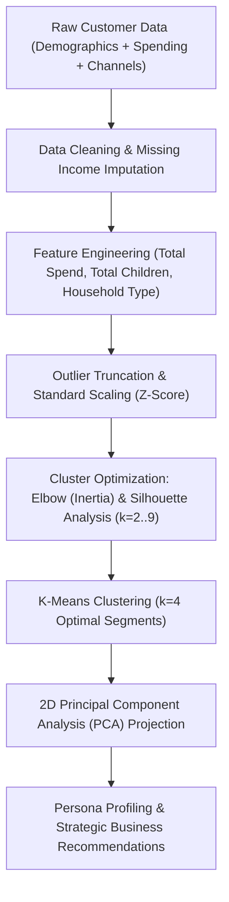

# 🎯 Customer Personality Segmentation & Behavioral Clustering

[](https://www.python.org/)
[](https://scikit-learn.org/)
[]()
[](../../LICENSE)

## 📌 Executive Overview
Targeting every customer with the same generic campaign leads to customer fatigue and low return on marketing investment (ROAS). This project implements an **Unsupervised Machine Learning System** that translates complex retail transactional and demographic histories into **4 actionable consumer personas**, empowering marketing teams to deliver hyper-targeted campaigns and optimize Customer Lifetime Value (CLV).

---

## 🔬 End-to-End Analytics Workflow



---

## 🛠️ Feature Engineering Highlights
Rather than relying solely on raw transactional fields, domain-driven feature aggregations were engineered:

1. **`Total_Spend`**: Sum of cumulative expenditures across 6 categories (Wines, Fruits, Meat, Fish, Sweets, and Gold products).
2. **`Total_Purchases`**: Aggregate transaction count across Web, Catalog, and Brick-and-Mortar Store channels.
3. **`Total_Children`**: Sum of young children (`Kidhome`) and teenagers (`Teenhome`) to capture household dependency.
4. **`Age`**: Derived from birth year with sanity bounds ($18 \le \text{Age} \le 90$).
5. **`Total_Accepted_Campaigns`**: Historical responsiveness across previous marketing promotions (Campaigns 1–5 + final response).

---

## 📈 Cluster Optimization & Validation

To rigorously establish the optimal number of clusters ($k$), both **Inertia (Elbow Method)** and **Silhouette Coefficients** were evaluated across $k \in [2, 9]$:

| $k$ | Inertia | Silhouette Score | Interpretation |
|:---:|:---:|:---:|---|
| $k=2$ | 48,336.7 | 0.2094 | Coarse split: High vs. Low spenders |
| $k=3$ | 44,589.4 | 0.1450 | Intermediate separation |
| **$k=4$** | **42,924.8** | **0.1500** | **Optimal balance of mathematical separation and high business interpretability** |
| $k=5$ | 41,087.0 | 0.0911 | Fragmented clusters |
| $k=6$ | 39,930.7 | 0.0865 | Over-segmentation |

---

## 👥 Discovered Customer Personas & Strategic Playbook

| Cluster ID | Persona Name | Avg. Income | Avg. Total Spend | Household Profile | Channel Preference | Strategic Marketing Playbook |
|:---:|---|:---:|:---:|---|---|---|
| **Cluster 0** | **Older, Steady Spenders** | ~$52,000 | ~$500 | Older adults, fewer children | In-store & Catalog | Loyalty rewards, seasonal discounts, high-retention email digests |
| **Cluster 1** | **Budget Families** | ~$35,000 | ~$90 | High child count, price-sensitive | Deals & Online | Bundle deals, essential product discounts, coupon codes |
| **Cluster 2** | **High-Income Luxury Enthusiasts** | ~$80,000+ | ~$1,300+ | Low child count, high disposable income | Store & Catalog | Premium wine/meat tastings, exclusive VIP clubs, zero discount messaging |
| **Cluster 3** | **Digital Value Seekers** | ~$48,000 | ~$300 | Mid-aged, single or small household | Web Visits & Online | Flash digital sales, abandoned cart recovery, mobile app push notifications |

---

## 🗺️ PCA Dimensionality Reduction
Using **Principal Component Analysis (PCA)**, the 9-dimensional standardized customer matrix was projected into 2 principal dimensions:
- **PC1 (Spending & Wealth Axis)**: Strongly driven by `Total_Spend`, `Income`, and `Total_Purchases`.
- **PC2 (Household Structure Axis)**: Strongly driven by `Total_Children` and `Age`.

This enables intuitive 2D cluster visualization and real-time monitoring of customer migration across segments over time.

---

## 📂 Repository Layout
```
02-customer-segmentation/
├── README.md                                # Comprehensive Business & ML Documentation
├── customer_personality_clustering.ipynb    # Jupyter Notebook with Interactive Plots & Heatmaps
└── src/
    └── customer_clustering_pca.py           # Production CLI Clustering & Profiling Script
```

---

## 🚀 How to Run

### Interactive Notebook
```bash
jupyter notebook customer_personality_clustering.ipynb
```

### Production CLI Execution
```bash
python src/customer_clustering_pca.py --data_path marketing_campaign.csv --n_clusters 4
```

---
*Developed by Amr Gamal as part of the EME Artificial Intelligence & Machine Learning Program.*
