# 📚 Student Academic Performance & Grade Regression

[](https://www.python.org/)
[](https://scikit-learn.org/)
[]()
[]()
[](../../LICENSE)

## 📌 Executive Overview
Early identification of at-risk academic trajectories allows educational institutions and guidance counselors to provide proactive remedial interventions. This project implements a **Predictive Regression Pipeline** on a large-scale dataset of **50,000 Egyptian student profiles**, modeling the interplay between socio-demographic factors, parental educational background, curriculum standards, and final student grades.

---

## 📊 Dataset Profile & Attributes

The dataset captures 50,000 student academic profiles partitioned into 40,000 training and 10,000 test cases:

| Feature | Category | Analytical Purpose |
|---|---|---|
| `Student year` | Academic Progress | Grade level / academic seniority |
| `Student Age` | Demographic | Biological age of the student |
| `Father Degree` / `Mother Degree` | Socioeconomic Background | Attained degree (High School, Bachelor, Master, PhD) |
| `EduType_*` | Curriculum Standard | System type: Thanweya Amma, IGCSE, International Baccalaureate (IB), American Diploma |
| `Both_Parents_Higher_Ed` | Engineered Indicator | Flag indicating dual-parent post-secondary education |
| `Age_Year_Mismatch` | Engineered Indicator | Identifies early entrance, grade skipping, or academic retention |
| `Grade` (Target) | Continuous Outcome | Final standardized composite grade (0–100 scale) |

---

## 🔬 Modeling Architecture & Pipeline

```mermaid
flowchart LR
    A["Raw Educational Records (50,000 Rows)"] --> B["Curriculum Dummy Encoding (Thanweya, IGCSE, IB)"]
    B --> C["Feature Engineering (Parental Aggregates + Age-Year Mismatch)"]
    C --> D["Multicollinearity Removal & Dimensionality Selection"]
    D --> E["Stratified Split (40k Train / 10k Test)"]
    E --> F["Z-Score Standardization (StandardScaler)"]
    F --> G["Regression Benchmark (OLS Linear Regression vs. Random Forest)"]
    G --> H["Tolerance Evaluation (±5 Mark Acceptance Margin: 73.31%)"]
```



---

## 🏆 Performance Evaluation & Results

Evaluated across $n = 10,000$ unseen test students:

| Model | MAE | RMSE | $R^2$ Score | Tolerance Accuracy ($\pm 5$ marks) | Key Strength |
|---|:---:|:---:|:---:|:---:|---|
| **Linear Regression (OLS)** | **3.60** | **4.51** | -0.0001 | **73.31%** | Fast, stable baseline with direct feature coefficient interpretability |
| **Random Forest Regressor** | 3.65 | 4.54 | -0.0080 | 72.85% | Captures non-linear thresholds in parent qualification features |

### 🎯 Domain-Specific "Tolerance Accuracy"
In academic grading, an exact point prediction is less critical than predicting a student's grade within a narrow band (e.g. $\pm 5$ points on a 100-point scale). Under this realistic criterion, the model achieves **73.31% precision**, proving its viability as a triage tool for early academic counseling.

---

## 📂 Project Organization
```
03-student-performance-prediction/
├── README.md                          # In-depth Educational Data Science Documentation
├── student_grade_regression.ipynb     # Exploratory Data Analysis & Modeling Notebook
└── src/
    └── train_student_regression.py    # Production Python Pipeline Script
```

---

## 🚀 Quickstart & Execution

### Interactive Notebook
```bash
jupyter notebook student_grade_regression.ipynb
```

### Production Script Execution
```bash
python src/train_student_regression.py --data_path egypt_education_dataset.csv --tolerance 5.0
```

---
*Developed by Amr Gamal as part of the EME Artificial Intelligence & Machine Learning Program.*
